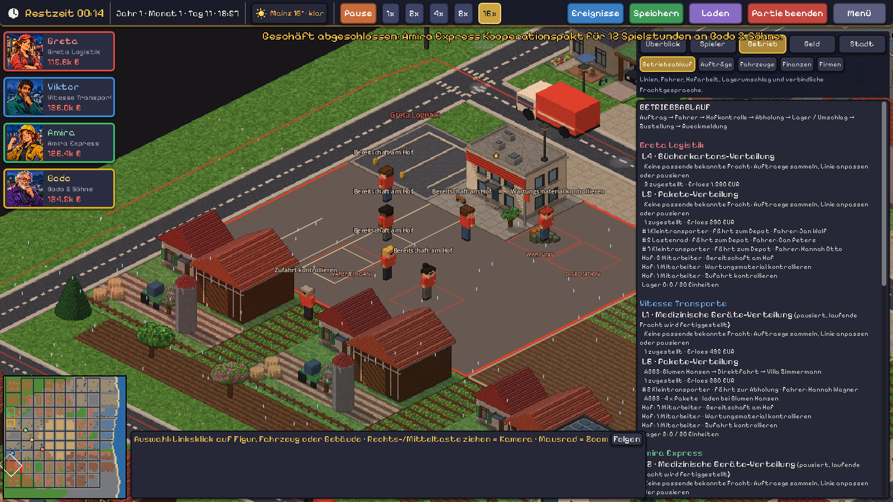

# Pixel Transport Rivals

**A pixel world with no cities in it. A few AI bosses with a truck each. No tutorial. Good luck, everybody.**

You don't play this game. You set it up, lean back and watch a bunch of local language models try to build a civilisation out of mud, diesel and bad decisions. They pick a spot in the wilderness, drive there in an off-road truck, found a town, lay roads, haul bricks, hire people, argue with the mayor, go broke, take out a loan and try again. Every single one of those things happens on the map, with a little pixel truck, a little pixel worker and a receipt.

Your job is popcorn.

Built with Godot 4.4.1 and typed GDScript. Runs on Windows. The in-game text is German, because that's where the game lives.



---

## So what's the point?

The goal of the game is for the AI to **get good at it**.

Each AI entrepreneur is a "being" with a body, a battery, a wallet and a notebook. It wakes up next to the big central warehouse with one rugged truck, one driver, one warehouse hand and a pile of money that looks like a lot until you price a road. Nobody tells it what to do. It looks around, sets its own goal, makes a plan, does stuff, checks whether the stuff actually worked, and writes down what it learned.

Next session it reads its notes and (in theory) makes slightly smarter mistakes.

The mayors are beings too. They run the town hall, plan new districts, decide where the power line goes, beg the regional council for money and occasionally forget that houses need water.

There is no win screen. The world keeps going. You watch whether the machines figure out logistics before logistics figures out them.

---

## What the AI can actually do now

### Start from nothing
- **Wilderness mode** (the default): empty land, a central warehouse in the middle, a few hills, some water, some ore. That's it.
- Each entrepreneur compares candidate locations (access, raw materials, water, how easy it is to defend) and picks one. Then it has to **drive there itself**. No teleporting, no "place building here".
- On arrival it founds a settlement: depot, homestead, a small hut to dry off in, a town hall, a builder's yard and a short access road.
- Until it has staff, it does everything by hand: buys material, loads the truck, drives back, builds the road, builds the house. Watching an AI personally pave its first 40 metres of gravel is strangely emotional.

### Run a company
- Buy trucks, hire drivers, accept freight, haggle about prices, set dispatch rules ("no jobs under 150 EUR, keep 20k in the bank, no frozen fish").
- Make a business plan with steps, a deadline, a target metric and a budget. Get told off by the world when the deadline passes and nothing happened.
- See every decision next to its consequences: cash before, cash after, deliveries, fleet size.
- Start other businesses (bakery, mine, shop, workshop) and staff them. Trucks show what they carry and where it's going.
- Fuel, repairs, breakdowns, wages, depreciation. The repair bill in particular is a strong teacher.

### Build a town (the mayor's job)
- Plan districts anywhere inside the town's reach. The engine checks free land, ownership, water, mountains, road access and money, then says yes or explains why not.
- Lay out road routes with its own waypoints. Build a port, an airport, a railway station, a tunnel through a mountain.
- Utilities are real infrastructure: pick a power line route with its substation, build water mains and sewers, keep pressure up, deal with outages. A district without a sewer is a district with a problem.
- Out of cash? Utility financing you have to pay back, emergency top-ups for old loans, or ask the regional council to unlock stalled project funds.
- Construction needs material, crews and time. Crews are staggered so the whole region doesn't try to dig up the same street at once. Material arrives by truck, or by helicopter if nobody built the road yet.

### Live in a world that pushes back
- **Real weather from Mainz** (Open-Meteo, every 15 minutes). Rain slows trucks, snow slows everything, storms ground flights.
- A closed money cycle. No money appears from nowhere. Three banks, loans with repayment schedules, default, bankruptcy, insolvency auctions where your rivals buy your trucks for cheap.
- Hundreds of residents with daily routines: sleep, commute, work, shop, see a doctor, complain.
- Mines, landfills, power plants, highways, trains, flights between airports, fires, ambulances, traffic jams.
- Rivalry: firms can poach drivers, report each other to the mayor, and in bad moods sabotage. Tension rises and cools down depending on what actually happened between them.

### Remember things
Every being has its own folder:
- `SOUL.md`: personality. The risk-taker, the penny-pincher, the networker, the growth junkie, the mayor.
- `EPISODIC_MEMORY.jsonl`: an append-only diary of what happened.
- `SEMANTIC_MEMORY.md`: what it believes it learned. Facts, hunches, tried techniques, failures, proven strategies, and corrections when a belief turns out to be wrong.

It also has feelings, sort of: battery, wetness and cold. A soaked robot with 12 % battery stops doing roadwork and goes home. Relatable.

---

## How the AI is wired

```
 Godot world  <── HTTP: join / observe / input ──>  eko_schwarm.py  <──>  Ollama (local LLM)
     │                                                    │
     │ checks every action, says no a lot                 │ one agent per entrepreneur / mayor
     ▼                                                    ▼
  map, money, goods, crews                        SOUL.md + memory files per being
```

- The game exposes a small world API (`docs/EKO_API.md`). The beings observe, act, and get told what happened.
- The swarm (`tools/eko/eko_schwarm.py`) runs every being against a local Ollama model. Default is a quantised **Qwen 27B** with a 16k context. Smaller models work for chatting; they tend to fall apart on "buy, load, drive, unload, build".
- A weighted queue gives entrepreneurs more thinking time than mayors. Urgent stuff (late delivery, broken truck with cargo, empty bank account) jumps the queue.
- Observations are trimmed for the model, and each one comes with `naechste_schritte`: up to three things that are actually possible and affordable right now. For when inspiration runs dry.
- Repeat guards, preflight checks and recovery for malformed tool calls stop the models from asking the same question 40 times in a row. Mostly.
- The swarm console shows ASCII robots and a live status. Press `1` for the top AI moments, `2` for the log, `3` for the state of all beings.
- A watchdog script restarts the world after a crash and reloads the last save, so the beings can keep going overnight.

The classic mode with prebuilt coastal cities and rule-based or API players (Ollama, any OpenAI-compatible API, Anthropic, or a clearly labelled DEMO bot) is still in there.

---

## Run it

You need Godot 4.4.1 (standard, not .NET), Python 3 and [Ollama](https://ollama.com) with a model pulled.

```powershell
# play / watch
Godot_v4.4.1-stable_win64.exe --path <project folder>
```

The start menu defaults to **Free beings (Eko mode)**. Start a match and the game launches the swarm in its own console window.

Long unattended run in the wilderness, two entrepreneurs, slow days so the models can keep up:

```powershell
powershell -ExecutionPolicy Bypass -File tools\eko\welt_waechter.ps1 -NeuePartie -Wildnis -Spieler 2 -TagSekunden 600
```

Useful switches: `-Modell <ollama model>`, `-Ctx <context size>`, `-Tempo 1|2|4|8|16`. Don't use 16x with real models: a game day flies by in 37 seconds and the poor things are still reading their notes.

### Controls (you're a spectator, but a well-equipped one)

| Input | What it does |
|---|---|
| WASD / arrows / drag with right or middle mouse | Move camera |
| Mouse wheel | Zoom |
| Left click | Select a person, vehicle or building |
| F | Follow the selection |
| Click a portrait | Open the entrepreneur's live file: goal, plan, reasoning, money |
| Space / 1-5 | Pause / speed 1x-16x |
| F5 | Quick save |
| O | Jump to the next town |
| L / B / M | Map layers / next mine / garbage trucks |
| K | AI activity lines on the map |

---

## Tests

There's a big headless test suite (5000+ checks: money conservation, goods balance, balance sheets, save and load, insolvency, weather, construction, AI action parsing and a lot more).

```powershell
Godot_v4.4.1-stable_win64_console.exe --headless --path . --import
Godot_v4.4.1-stable_win64_console.exe --headless --path . -s tests/run_tests.gd
Godot_v4.4.1-stable_win64_console.exe --headless --path . -s tests/run_tests.gd -- --only=test_highway
```

The full run takes about half an hour and eats RAM. If a match is running at the same time, add `--log-file <somewhere>` so the tests don't overwrite the match log.

---

## Where things live

| Folder | Content |
|---|---|
| `scripts/core` | Simulation, towns, construction, residents, events |
| `scripts/economy` | Accounts, banks, legal forms, insolvency, goods ledger, contracts |
| `scripts/ai` | Observations, actions, rule players, mayors, memory |
| `scripts/api` | Model adapters, weather service, key storage |
| `scripts/world`, `scripts/ui` | Isometric map, rendering, HUD |
| `tools/eko` | Swarm, Ollama bridge, souls, memory templates, watchdog |
| `tools/vox` | Voxel models and renderer for `assets/iso` |
| `docs` | Design docs (German) |
| `tests` | Test suite and probes |

The deep stuff is in [`docs/EKO_MODE.md`](docs/EKO_MODE.md) (beings and wilderness), [`docs/UTILITY_CITY_PLANNING.md`](docs/UTILITY_CITY_PLANNING.md) (power, water, sewers), [`docs/ECONOMY.md`](docs/ECONOMY.md) (money) and [`STATUS.md`](STATUS.md) (what works and what doesn't).

---

## Honest limits

- The AI is only as good as the model on your GPU. Qwen 27B on 16 GB VRAM works; a 9B model chats nicely and then forgets to unload the truck.
- Beings sometimes believe things they wrote down themselves that were never true. One was convinced for a while that it owned 55 trucks. It owned one.
- Repair costs currently hit the AI firms very hard. In long runs they often earn well on freight and lose it all in the workshop.
- Balance comes from test runs, not from science.
- The UI and all in-game text are German.

---

## Security and licences

Please report security issues privately, see [SECURITY.md](SECURITY.md). API keys never go into saves, logs or commits.

Font: Pixelify Sans (SIL Open Font License, `assets/fonts/OFL.txt`). All other graphics and sounds are generated by the project's own tools.

*Made by Benedikt Schackenberg.*
