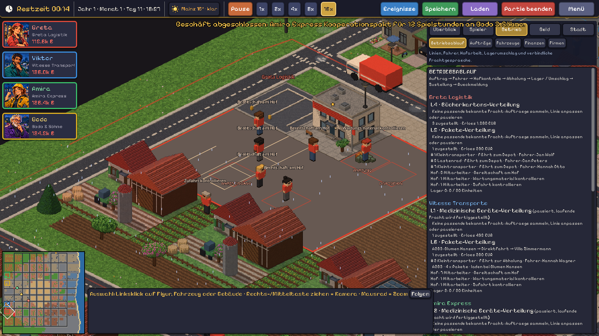

# Zusammenhängender Speditionsbetrieb

Stand: 01.11.2026. Orientierung sind die wiederkehrenden Linien, der Warenumschlag und die lesbaren Betriebszustände von Transport Fever. Die vorhandene Stadt- und Wirtschaftssimulation bleibt die Grundlage.

## Was sich im Spiel ändert

Ein Fahrzeugkauf ist der Anfang einer Betriebskette. Die Disposition weist einen verfügbaren, geeigneten Mitarbeiter zu. Der Mitarbeiter läuft zum Fahrzeug; ohne Fahrer fährt es auch beim Händler oder beim Einparken nicht los. Vor der nächsten Tour kehrt es zur Hofkontrolle zurück. Danach folgen Abholung, optionaler Umschlag auf dem Betriebshof, Zustellung und Rückmeldung. Auf dem Hof fahren Fahrzeuge langsam zu Ladezone und Stellplatz. Gebäudegrundflächen werden bei diesen Hofwegen ausgespart.

Die KI kann eine **Transportlinie als Dauerauftrag** erteilen. Die Linie bedient ausschließlich bekannte, passende Frachten innerhalb der vorhandenen Regeln. Ausreichende Fahrzeugkapazität, Ruf, Kühlung, Lagerkapazität, Frist und ein geschätzter positiver Fahrtbeitrag sind Voraussetzungen. Zeit und Kosten sind Planungsschätzungen; Stau, Sperrungen oder spätere Störungen können das Ergebnis verändern. Preiswahl, Investitionen, Finanzierung, Personalbeschaffung und die Entscheidung über Linien bleiben beim Unternehmer.

`via_depot=true` bedeutet zwei echte Transportabschnitte: Quelle → Firmenlager, anschließend Firmenlager → Kunde. Erst nach dem ersten Abschnitt gibt es einen Lagerbestand, den der zweite Abschnitt laden kann. Einlagern erzeugt keinen Transporterlös. Die Vergütung entsteht wie bisher bei vollständiger Kundenzustellung. `via_depot=false` vermeidet einen unnötigen Lagerumweg. Der Demo-Spieler entscheidet anhand der Entfernung, welche Variante er nutzt.

## Sichtbare Arbeit und Kommunikation

| Beteiligter | Sichtbare Aufgabe | Zusammenhang |
|---|---|---|
| Unternehmer | Disposition am festen Arbeitsplatz; Besuche und Gespräche bleiben möglich | Keine zufälligen Spaziergänge in Leerlaufphasen |
| Fahrer | Fahrzeug abholen, Hofkontrolle, Tour, Rückfahrt, Einparken | Fahrzeugposition und tatsächliche Fahrerzuweisung gehören zusammen |
| Hofpersonal | Kommissionieren zwischen Lager und Ladezone, Frachtpapiere, Zufahrt, Wartungsmaterial, Pause | Benannte Tätigkeiten; verfügbare Verlader auf dem Hof verbessern die Ladezeit |
| Disposition | Auftragszuweisung, Einlagerungs- und Zustellmeldung | Meldungen beziehen sich auf echte Fahrzeug- und Auftrags-IDs |
| Mitunternehmer | Frachtanfrage, Preisangebot, Gegenangebot, Bestätigung | Erst eine Einigung schafft einen verbindlichen Unterauftrag |
| Bürger | Wohnung, Arbeitsziel, Einkauf, Restaurant oder Arbeitsvermittlung | Wege nutzen vorhandene Wohn- und Arbeitgeberdaten; keine doppelten Geldbuchungen |

Der Bereich **Betrieb → Betriebsablauf** zeigt Linienstatus, tatsächlich zugestellte Frachten, Erlöse, Fahrer, nächste Ladestelle, Hofaufgaben und Lagerbelegung. Darunter steht der Betriebsfunk. Unternehmerbegründungen stehen weiterhin unter **Spieler → Entscheidungen** mit der bestehenden Herkunftskennzeichnung.

Betriebsmeldungen sind Rückmeldungen der Simulation. Sie werden nicht als neue Antworten eines Sprachmodells ausgegeben. Auch die sichtbaren Bürgerwege sind eine Tagesroutine auf Grundlage der Simulationsdaten, keine separaten Modellaufrufe.



Der Hof zeigt Arbeitszonen und Stellplatzmarkierungen auf befestigtem Boden. Frachtkisten richten sich nach dem real eingelagerten Bestand; vorhandener Treibstoff und Ersatzteile sind ebenfalls sichtbar. Markierungen ersetzen keine kostenpflichtige Lagerhalle, Werkstatt oder Laderampe. Deren Kapazitäten und Baukosten gelten weiterhin.

## Neue KI-Aktionen

```json
{"action":"create_transport_line","name":"Paketverteilung","cargo":"pakete","vehicle_ids":[1],"via_depot":true}
```

`pickup_id` und `dropoff_id` können die Linie auf feste Halte beschränken. Ohne diese Parameter bedient sie wechselnde Kunden derselben Warenart. IDs müssen aus der eigenen Beobachtung stammen. Fahrzeuge sind für die Linie reserviert. Ein paralleler Einzelauftrag, Verkauf oder eine Vermietung wird abgelehnt. `pause_transport_line` beendet die Annahme neuer Frachten; bereits disponierte Ware wird fertig zugestellt, bevor die Fahrzeuge frei werden.

```json
{"action":"request_transport_help","contract_id":"A17","max_fee":300}
{"action":"quote_transport_help","request_id":"H1","fee":240}
{"action":"counter_offer","offer_id":"G1","price":220}
{"action":"accept_trade","offer_id":"G2"}
```

Diese Aktionen kommen von unterschiedlichen Unternehmen: Der Auftraggeber fragt eigene unverplante Fracht an und begrenzt den Preis. Ein anderer Unternehmer gibt einen Preis ab. Der Auftraggeber kann annehmen oder einen Gegenpreis anbieten; beim Gegenpreis muss der Partner zustimmen. Eine offene Verhandlung bleibt derselben Anfrage zugeordnet. Anfragen und Angebote übertragen weder Geld noch Frachtrechte. Nach beiderseitiger Einigung disponiert die Betriebsroutine den akzeptierten Unterauftrag mit vorhandenen geeigneten Fahrzeugen und Fahrern. Bezahlt wird nach der tatsächlichen Lieferung über das bestehende Vertragssystem. Veraltete Anfragen und Verpflichtungen eines früheren Unternehmens werden zurückgewiesen.

```json
{"action":"set_operations_policy","auto_driver":true,"return_home":true,"yard_checks":true}
```

Die drei Routinen sind standardmäßig aktiv und einzeln abschaltbar. Die Fahrerautomatik besetzt neu gekaufte oder für eine Linie benötigte Fahrzeuge mit bereits angestellten, verfügbaren Fahrern. Sie wirbt niemanden an und kauft keine Fahrzeuge. Explizite Mitarbeiteraufgaben haben Vorrang vor Hofroutinen.

Linien, laufende Frachtabschnitte, Richtlinien und Verhandlungen werden gespeichert. Alte Spielstände ohne diese Daten bleiben ladbar.

## Prüfen

```powershell
Godot_v4.4.1-stable_win64_console.exe --headless --path . --editor --import
Godot_v4.4.1-stable_win64_console.exe --headless --path . -s tests/run_tests.gd -- --only=test_company_operations
python tests/mock_operations_api.py --godot C:\Godot\Godot_v4.4.1-stable_win64_console.exe
```

Die Integrationstests prüfen zwei aufeinanderfolgende Frachten mit tatsächlicher Zwischenlagerung, Speicherstände während der Hofanfahrt und nach Einlagerung, Fahrerpflicht, sichtbare Hofaufgaben, Verhandlung mit Gegenangebot, verspätete/unwirtschaftliche Planung, Reservierungen und einmalige Abrechnung. Der HTTP-Test verwendet den echten API-Adapter mit einem lokalen Testserver und synthetischen Antworten; er benötigt keinen API-Key und ist kein Test der Qualität eines Sprachmodells.

Der Gesamtlauf bestand 5094 Prüfungen ohne Testfehler. Nach Übernahme der aktuellen Demo-KI wurden deren Finanztest (4 Prüfungen), lokale Aktionswahl (8), Handel (10) und die 48 Betriebsablauf-Prüfungen separat wiederholt. Der HTTP-Lauf lieferte A13 nach ausgehandeltem Gegenpreis aus: 100 gültige Antworten, keine Adapterfehler und keine abgelehnten Aktionen.

Ein reproduzierbarer grafischer Probelauf:

```powershell
Godot_v4.4.1-stable_win64_console.exe --path . -- --autotest --players=4 --seconds=45 --speed=16 --map=128 --seed=21 --fault=0 --weather=sim --interval=3 --screenshot=C:\temp\betrieb.png --shot-at=25 --shot-follow=plot0 --shot-zoom=1.1 --tab=Betriebsablauf --hour=11
```

## Grenzen

- Eine Linie disponiert aktuell eine vollständige Fracht nach der anderen. Mehrere reservierte Fahrzeuge können die beiden Abschnitte übernehmen; eine automatische Bündelung vieler Aufträge oder eine Fahrplanoptimierung gibt es noch nicht. Manuelle Mehrstopp-Touren bleiben verfügbar.
- Die wirtschaftliche Balance ist damit nicht fertig. Insbesondere deckt eine kurz laufende, schwach ausgelastete Firma mit zehn Startmitarbeitern ihre Fixkosten häufig nicht.
- Der neue Stand wurde mit Godot 4.4.1 unter Linux sowie im tatsächlichen Renderer geprüft. Eine neue Windows-EXE und ein Live-Test mit kostenpflichtigen Modell-APIs gehören nicht zu dieser Prüfung.
- Die schon im Ausgangsstand auftretenden Ressourcenwarnungen beim Beenden sind noch vorhanden.
